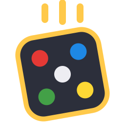

<p align="center"></p>

# DiceDrop

Serverless, peer-to-peer Ludo for **2 to 8 players** on Windows. It ships as one portable `DiceDrop.exe`: no installer, no .NET install, nothing written to the registry. The game window is **excluded from screen capture**.

## Build and run

```
build.cmd                # runs all tests, then writes dist\DiceDrop.exe (self-contained, ~59 MB)
```

It works from cmd, PowerShell (`.\build.cmd`), Git Bash (`./build.cmd`) or a double-click. Pass a folder to publish somewhere other than `dist`.

Copy `DiceDrop.exe` to any Windows 10 (2004+) or Windows 11 PC and run it. On first launch, Windows Firewall asks whether to allow it. Choose **Allow** for private networks, because peers connect directly to each other.

For development: `dotnet build DiceDrop.slnx`, `dotnet test DiceDrop.slnx`.

**Updates.** At startup and every 6 hours after that, DiceDrop asks GitHub for the latest release. If it is newer than the running version, a banner appears at the bottom right, and clicking it opens the release page in your browser. Nothing is downloaded or installed automatically. Without internet access the check fails quietly (the reason shows in the network log). Release builds get their version from the tag. `build.cmd` uses the newest `vX.Y.Z` tag behind the current commit (or `DICEDROP_VERSION` if set, e.g. `set DICEDROP_VERSION=0.1.1`); a build with no tag, or a plain `dotnet build`, is versioned 0.0.0 and never checks.

## Playing

1. Everyone opens `DiceDrop.exe`. There is no menu: each copy finds the lobby on the network and joins it, or opens one if there is none yet. Players appear under their Windows account name.
2. Whoever opened the lobby is its host. If two players open lobbies at the same moment, the smaller one closes and its players move to the other within a second or two, so everyone ends up together. If the host leaves, the longest-standing member takes over and nothing else changes.
3. **Anyone** in the lobby can click **Start a game**. Everyone else gets an invite (in the lobby, or as a corner notice if DiceDrop is in the background) and chooses **Join game** or **Not now**. Whoever started it sees who is in and clicks **Begin game** when ready.
4. Roll by clicking the dice or pressing **Space**, then click one of your bouncing pawns. Pawns hop square by square; a captured pawn slides back to its yard.
5. Members who are not playing can **Watch** the game live from the lobby. Players can **Leave game** at any time and keep watching. Whoever started the game can **Stop game** for everyone at any time. One game runs per lobby at a time, and the lobby (with its chat) stays open throughout, so the next game can start as soon as this one ends.

The board is the classic cross-shaped Ludo board, turned so your own yard is at the bottom left. Two or three players use the full four-arm board (two players sit in opposite corners); five to eight players get a six-, seven- or eight-armed star built from the same arms.

Rules: a 6 brings a token out; 6, a capture, or bringing a token home earns another roll; three 6s in a row forfeit the turn; start and ★ squares are safe; you need the exact roll to finish. The game continues until everyone has a finishing place.

**Playing over the internet:** the game has no relay server and finds lobbies by LAN broadcast, so peers must share a network. A virtual LAN that carries broadcasts (ZeroTier, Radmin VPN) works; Tailscale does not forward broadcasts.

## Ports

No port number can be guaranteed free on Windows. Its dynamic range can cover almost every port (1024–65535 on some PCs), and Hyper-V/WSL reserve random blocks. So the game never *depends* on a particular port:

- **Game traffic (TCP).** The host tries port 47777 and binds it exclusively, so no other program can share it or intercept peers. If something already holds it, the host takes any free port the OS offers instead. Joiners always use an OS-chosen port. Anything that connects without the game's handshake is dropped.
- **Discovery (UDP broadcast).** Hosts send a beacon once a second to ports 47778, 45778 and 43778. Browsers listen on every one they can bind, so discovery keeps working if one is taken. The beacon carries the host's real game port, so a fallback port is found automatically. Wi-Fi often drops broadcasts, so once a PC is heard, beacons also go to it directly (unicast, which Wi-Fi delivers reliably) for as long as it keeps announcing.
- **Auto-lobby.** While idle, joins the best lobby it hears about (most players, then lowest id), or opens one after 1.5-3 s of silence. A host whose lobby is outranked by another that has room for its players closes it and moves there; its guests follow. A lobby with a game being set up or played never merges away. Lobbies keep announcing themselves during games, so latecomers join and can watch. A lobby you joined or tried to join is skipped for 20 seconds, which stops lobbies bouncing players around without letting one failed attempt keep PCs apart. Hearing can be one-way (a firewall on one PC), so a host whose lower-ranked rival hasn't moved to it within 6 s moves there itself.

## When PCs don't find each other

Press **F12** (or the *Network log* button, bottom left) on both PCs. The log is kept in memory only and shows, in order:

- **env**: this PC's adapters, which network profile is in use (Private/Public), and the Windows Firewall rules for this exact exe. Lines starting with `PROBLEM` name the cause and the fix, such as a BLOCK rule Windows added when its prompt was cancelled, or a rule that only covers Private while the network is Public. Rules are tied to the exe's path, so moving `DiceDrop.exe` needs a new rule.
- **udp**: which discovery ports opened, where beacons go, and whom we heard (every 10 s when that changes, else once a minute). "Heard only beacons from this PC" means no other PC's beacons arrive: check the firewall on both PCs, that both are on the same subnet, and that the router's Wi-Fi client (AP) isolation is off.
- **tcp**: connections in and out with the reason a connect failed (timed out: usually the host's firewall; refused: nothing listening).
- **lobby**: what auto-lobby decided (join, host, merge) and why.

*Copy all* puts the log on the clipboard so both PCs' logs can be compared.

## Architecture

Clean Architecture. Dependencies point inward only, and the compiler enforces it through project references.

```
 Presentation.Wpf ──► Application ──► Domain
        │                  ▲
        └──► Infrastructure┘
```

| Project | Responsibility | May depend on |
|---|---|---|
| `Ludo.Domain` | Entities and rules: `LudoGame` aggregate, N-player `BoardTopology` (at least four arms), `GameRules`, domain events. Pure and deterministic, with no I/O, time or randomness. | nothing |
| `Ludo.Application` | Use cases (`AutoLobby`, `HostLobby`, `JoinLobby`, `ProposeGame`, `AcceptInvite`/`DeclineInvite`, `StartGame`, `RollDice`, `MoveToken`, `LeaveGame`, `StopGame`, `LeaveSession`), **ports** (`IPeerNetwork`, `ILobbyDiscovery`, `ICryptoProvider`, `ISessionPresenter`), the sync protocol and fair dice. | Domain |
| `Ludo.Infrastructure` | Adapters for the ports: TCP mesh transport, UDP LAN discovery, SHA-256/CSPRNG, JSON wire format. | Application |
| `Ludo.Presentation.Wpf` | MVVM UI, board renderer, capture protection, and the **composition root** (`App.xaml.cs`), the only place that knows every layer. | Application, Infrastructure |

The UI never touches the domain. It receives immutable read models (`SessionSnapshot`) through the `ISessionPresenter` output port.

## How peers stay in sync

- **Mesh, not server.** Every lobby member connects to every other. The host only keeps the member list and greets newcomers; if it leaves, the first remaining member in join order takes over, and every peer picks the same one because they all hold the same list.
- **Games inside the lobby.** Whoever proposes a game is its *initiator*. If two invites cross, the one with the lower id wins on every peer. The initiator seats itself plus everyone who accepted and sends the start message. Only the initiator can stop the game, and the game ends if the initiator leaves the lobby.
- **Spectators** take no part in the dice protocol. The initiator keeps a record of every roll, move and drop-out and streams it to everyone not playing. Late joiners and players who leave get the whole record and replay it on a fresh board, and a spectator that notices a gap asks for it again.
- **Deterministic lockstep.** Ludo is turn-based, so only the current player may act. Each peer applies every roll and move to its own `LudoGame` and validates it against the rules. Illegal or out-of-turn actions are rejected locally.
- **Ordering.** All session state changes run one at a time on a single executor. A message that arrives ahead of one it depends on (for example a move before the roll it belongs to) is parked and retried.
- **Desync detection.** Every roll request carries a state digest. A mismatch is logged on every peer.

### Fair dice, with no trusted roller

Each player generates a fresh secret hash chain for every game and publishes its end (the *anchor*) when it accepts the invite. The initiator freezes all anchors into the start message, and each player cross-checks them against the anchors it received directly. For roll *i*, every peer reveals chain value *i*, which anyone can verify against value *i − 1*. The die is `SHA-256(i ‖ all reveals in seat order) mod 6 + 1`.

All values are fixed before the first roll, so nobody (not even whoever reveals last) can steer a die, and nobody can predict a die until every peer has revealed. A forged reveal fails verification on every peer, and the forger is removed.

## Screen-capture protection

What it does:

- The window gets `SetWindowDisplayAffinity(WDA_EXCLUDEFROMCAPTURE)` in `OnSourceInitialized`, *before it is ever shown*, so no frame is ever capturable. Captures show whatever is behind the window. On older Windows 10 builds it falls back to `WDA_MONITOR` (captures show black).
- **Fails closed.** If protection cannot be applied, the app refuses to run. A 200 ms watchdog re-checks the affinity. If something strips it, the content is removed at once and the window closes unless protection can be restored.
- A process-wide WinEvent hook protects every other top-level window the process creates (popups, menus, dialogs). Tooltips and context menus are disabled app-wide, and notices are shown inside the window rather than in message boxes.

This defeats PrintScreen, Snipping Tool / Win+Shift+S, Xbox Game Bar, OBS, ShareX, Teams/Zoom/Discord/Meet screen sharing, and any tool using GDI, Windows.Graphics.Capture or DXGI desktop duplication.

**What no software can prevent** (being explicit, since "at any cost" isn't technically achievable on a PC the player controls):

- A phone camera pointed at the monitor, or an HDMI capture card / video splitter.
- A user with admin rights running a kernel driver, a patched DWM, or code injected into this process.
- Running the game inside a VM and capturing from the host. Remote Desktop and similar tools *are* covered in normal sessions.

## Limitations and ideas

- No reconnection: a peer that drops mid-game is removed and the game continues without it.
- If a peer crashes halfway through broadcasting its dice reveal, peers can in rare cases disagree. The state digest detects it but does not repair it.
- No relay or NAT traversal (see "Playing over the internet").
- Possible next steps: turn timer, rule variants in the lobby (`GameRules` already supports them), reconnect with state transfer, sound.

## Contributing

Contributions are welcome: bug reports, fixes, features, tests and docs. See **[CONTRIBUTING.md](CONTRIBUTING.md)** for the full step-by-step guide, from forking and cloning to opening a pull request, with every git command you need.

## License

DiceDrop is open source under the **[MIT License](LICENSE)**. You are free to use, copy, modify and distribute it, including commercially, as long as the copyright notice and license text are kept.
